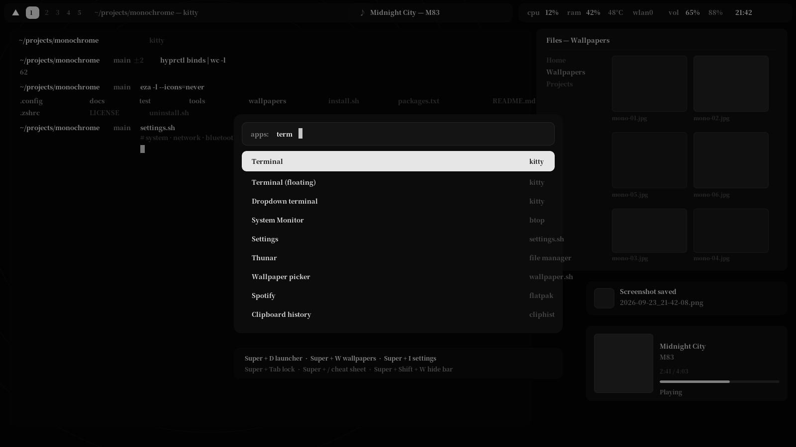

# hyprland-monochrome

A clean, monochrome Hyprland desktop for **Arch, EndeavourOS, CachyOS, Manjaro** (and any other
Arch-based system). Simple, modern, quiet — and built so you can actually find things again
six months from now.

```
Hyprland (Lua config) · Waybar · Rofi · awww · hyprlock · hypridle · hyprsunset
Kitty · Thunar · Zsh + Starship · dunst · cliphist · PipeWire · NetworkManager
```



<p align="center">
  <em>Black surfaces, white text, greys in between — no accent colour to fight with your wallpapers.</em><br>
  <small>(<code>docs/preview.svg</code> is a mockup of the layout, not a screenshot — open
  <code>docs/preview.html</code> for a preview generated from the config itself)</small>
</p>

<p align="center">
  <a href="docs/desktop-demo.mp4">▶ <b>Watch the live 1080p desktop session</b></a> — Waybar, Rofi
  menus, 16K wallpapers, Thunar, Dunst, <code>record.sh</code> and the full test suite running live ·
  or <a href="docs/test-run.mp4">watch the terminal-only test run</a>.<br>
  <small>(real Wayland session captured with <code>wf-recorder</code> via <code>tools/record-desktop.sh</code>)</small>
</p>

---

## What you get

| | |
| --- | --- |
| **Hyprland** | Tiling with sensible gaps, blur, soft animations, `Super`-based keybinds, vim-style focus, scratchpad, dropdown terminal, per-app window rules |
| **Waybar** | Floating pill groups, workspaces, now-playing, CPU/RAM/temp, updates, network, Bluetooth, volume (scroll to change), battery, tray, clock with calendar |
| **Rofi** | App launcher, window switcher, clipboard history, wallpaper grid, settings menu, power menu, searchable keybind cheat sheet — all on one monochrome theme |
| **Settings menu** | `Super + I`: system info, Network, Bluetooth, Monitors (resolution, scale, rotation, position, on/off — saved to a real config file), Sound (sinks, per-app volume), night shift, and shortcuts to every config file |
| **Wallpapers** | `Super + W`: thumbnail grid, random/next/prev, solid colours, remembers your choice across reboots. Six generated monochrome designs, drawn from maths — `wallpapers/generate.py` renders any resolution natively (4K, 8K, 16K), and a 16K `mono-06` ships ready |
| **Lock & logout** | hyprlock (blurred screenshot, monochrome, no colour leaks) + a Rofi power menu with confirmations. Optional wlogout grid if you prefer it |
| **Screenshots** | `Super + Print` area, `Super + Shift + Print` whole screen, `Super + Ctrl + Print` window — saved to `~/Pictures/Screenshots`, copied to the clipboard, previewed in a notification |
| **Recording** | `Super + Alt + Print` starts/stops a screen recording (`Super + Alt + Shift + Print` for an area), `Super + Alt + S` saves the last minute, `Super + Alt + P` pauses. Uses gpu-screen-recorder if installed, falls back to wf-recorder; a dot appears in the bar while recording |
| **Idle & light** | hypridle (dim → lock → screen off → suspend) and hyprsunset (automatic blue-light filter, `Super + Shift + N` to toggle) |
| **Shell** | Zsh with Starship (monochrome prompt), autosuggestions, syntax highlighting, fzf history, `eza`/`bat`, useful aliases and functions |
| **Spotify** | Optional Spicetify theme: greyscale UI, album art is the only colour left in the app |
| **Windows** | Dual-booter? `windows/` holds a matching GlazeWM config and Windows Terminal scheme, generated from the same palette — [docs/ON-WINDOWS.md](docs/ON-WINDOWS.md) |

---

## Install

```bash
git clone https://github.com/<your-user>/hyprland-monochrome.git
cd hyprland-monochrome
./install.sh
```

That's it. The installer:

1. checks it is really talking to an Arch-based system and that Hyprland is new enough,
2. installs everything in `packages.txt` from the official repos (nothing from the AUR is required),
3. offers the optional extras in `aur-packages.txt` if you have `paru` or `yay`,
4. **backs up every file it replaces** — twice (see below),
5. copies the configuration into `~/.config` (or symlinks it with `--link`),
6. copies the wallpapers, makes the scripts executable, offers to set Zsh as your shell,
7. reloads Hyprland and reports any config errors it finds.

Then **log out and back in**, choosing the *Hyprland* session.

```text
./install.sh --help          all options
./install.sh --yes           no questions (good for a fresh VM)
./install.sh --no-packages   only install the config files
./install.sh --link          symlink instead of copy (edit in place, git-friendly)
./install.sh --dry-run       show what would happen, touch nothing
./uninstall.sh               remove the config and put your old files back
```

### Backups

Two folders are kept, and they mean different things:

```text
~/.config-backups/pristine/     your files exactly as they were before the FIRST install
                                (never overwritten, so re-installing cannot bury them)
~/.config-backups/<timestamp>/  what that particular run replaced, with restore.sh
```

Restore at any time:

```bash
~/.config-backups/pristine/restore.sh     # put your originals back
./uninstall.sh                            # remove the config, then restore the originals
./uninstall.sh --list                     # see what is available
```

Already have a desktop set up? `--link` is pleasant: the repo stays the source of truth and
`git pull` updates your desktop.

---

## Keybinds

`Super` is the main modifier. The full, always-up-to-date table lives in
**[docs/KEYBINDS.md](docs/KEYBINDS.md)** — and `Super + /` shows a searchable version of it
built from your live config.

| Keybind | Action | | Keybind | Action |
| --- | --- | --- | --- | --- |
| `Super + T` / `Super + Enter` | Terminal | | `Super + F` | Fullscreen |
| `Super + D` | App launcher | | `Super + Shift + F` | Maximize |
| `Super + E` | File manager | | `Super + Space` | Floating (centred) |
| `Super + B` | Browser | | `Super + G` | Group windows (tabs) |
| `Super + I` | Settings menu | | `Super + 1..0` | Switch workspace |
| `Super + W` | Wallpaper picker | | `Super + Shift + 1..0` | Move window to workspace |
| `Super + V` | Clipboard history | | `Super + S` | Scratchpad |
| `Super + O` | Cycle window opacity | | `Super + Shift + T` | Dropdown terminal |
| `Super + /` | Keybind cheat sheet | | `Super + Tab` | Lock screen |
| `Super + Shift + W` | Toggle the top bar | | `Super + Escape` | Logout menu |
| `Super + Shift + R` | Reload the config | | `Super + Q` | Close window |
| `Super + Print` | Screenshot (area) | | `Super + Shift + E` | Quit the session |
| `Super + Alt + Print` | Record screen (again = stop) | | `Super + Alt + S` | Save the last minute |

Focus with `Super + H/J/K/L` (or the arrow keys), move windows with `Super + Shift + H/J/K/L`,
resize with `Super + Ctrl + H/J/K/L`, drag with `Super + left mouse`, resize with
`Super + right mouse`, switch workspaces with `Super + scroll`.

---

## Layout

```text
~/.config/hypr/
├── hyprland.lua              entry point: loads the modules below
├── hyprlock.conf             lock screen
├── hypridle.conf             idle: dim → lock → screen off → suspend
├── hyprsunset.conf           blue-light filter profiles by time of day
├── modules/                  ← everything you normally edit
│   ├── user.lua              your programs, gaps, keyboard, paths, toggles
│   ├── monitors.lua          monitor layout (+ monitors-user.lua from the settings menu)
│   ├── appearance.lua        borders, blur, animations, input devices
│   ├── autostart.lua         what starts with the session
│   ├── binds.lua             every keybind, commented
│   └── rules.lua             window + layer rules
└── scripts/                  bash that powers the menus and the desktop
```

Everything else is where you would expect it: `~/.config/waybar`, `~/.config/rofi`,
`~/.config/kitty`, `~/.config/dunst`, `~/.config/starship.toml`, `~/.config/btop`,
`~/.config/fastfetch`, `~/.zshrc`.

Config files are hot-reloaded when you save them (`hyprctl reload` does it by hand).
After editing `binds.lua`, refresh the docs with `python3 tools/keybind-table.py`.

---

## Make it yours

Start with **`~/.config/hypr/modules/user.lua`** — it is the one file that holds your
browser, terminal, gaps, keyboard layout, wallpaper paths and a few toggles. The other
modules read from it, so you rarely need to touch them.

Common edits:

```lua
-- modules/user.lua
browser  = "brave",            -- Kitty, Thunar, Zsh and Starship are the defaults
gaps_out = 14,
blur_enabled = false,          -- noticeably lighter on old GPUs
kb_layout = "us,ara",          -- Super + X switches between them
```

The palette is deliberately small and repeated in a few places, one comment per file tells
you what to change:

| What | File | Key |
| --- | --- | --- |
| Window borders, blur, opacity | `hypr/modules/appearance.lua` | `col.active_border`, `decoration.blur` |
| Bar colours | `waybar/style.css` | `.modules-left`, `#workspaces button.active` |
| Menus (all of them) | `rofi/theme.rasi` | the palette block at the top |
| Terminal | `kitty/theme.conf` | 16-colour greyscale ramp |
| Prompt | `starship.toml` | `[palettes.mono]` |
| Notifications | `dunst/dunstrc` | `[global]` colours |
| btop / fastfetch | `btop/themes/mono.theme`, `fastfetch/config.jsonc` | — |

More recipes — adding keybinds, Waybar modules, a second monitor, a different terminal,
new Rofi menus, the Spotify theme — are in **[docs/CUSTOMIZE.md](docs/CUSTOMIZE.md)**.

---

## Documentation

| File | What is in it |
| --- | --- |
| [docs/QUICKSTART.md](docs/QUICKSTART.md) | **start here** — install, first login, first keybinds, updating, uninstalling |
| [docs/INSTALL.md](docs/INSTALL.md) | requirements, sessions (uwsm/SDDM/GDM/ly), manual install, updates, uninstall |
| [docs/KEYBINDS.md](docs/KEYBINDS.md) | the complete keybind table (generated from the config) |
| [docs/preview.html](docs/preview.html) | a preview page generated from the config: bar modules, keybinds, palettes, packages |
| [docs/CUSTOMIZE.md](docs/CUSTOMIZE.md) | how to change programs, colours, bar modules, menus, monitors, shell |
| [docs/TROUBLESHOOTING.md](docs/TROUBLESHOOTING.md) | the things that actually go wrong, and how to fix them |
| [docs/ON-WINDOWS.md](docs/ON-WINDOWS.md) | Windows + Linux: what runs where, per-distro install notes, WSL2, and the generated `windows/` kit |

Useful scripts, if you prefer the terminal:

```bash
~/.config/hypr/scripts/settings.sh         # the settings menu
~/.config/hypr/scripts/wallpaper.sh pick   # wallpaper picker
~/.config/hypr/scripts/menu.sh keybinds    # keybind cheat sheet
~/.config/hypr/scripts/screenshot.sh region
~/.config/hypr/scripts/record.sh toggle     # record; press again to stop
~/.config/hypr/scripts/record.sh replay     # save the last minute
~/.config/hypr/scripts/record.sh path       # where the videos live
```

---

## Tests

The scripts are tested without a running compositor, so you can hack on them safely:

```bash
./test/run-all.sh                # everything below, in one go
./test/smoke-test.sh             # 100 checks: stubs hyprctl/rofi/awww/gpu-screen-recorder/…
./test/install-sandbox.sh        # installs into a throw-away HOME: backups, --link, uninstall
python3 tools/keybind-table.py --check   # is docs/KEYBINDS.md still accurate?
python3 tools/build-preview.py --check   # is docs/preview.html still accurate?
python3 tools/build-preview.py           # rebuild docs/preview.html after editing the config
python3 tools/build-windows-kit.py --check  # is the Windows kit still in step with the palette?
```

The smoke test builds a throw-away `$HOME`, stubs every external tool and asserts on what
each script actually does — it caught real bugs (quoting, jq pipelines, backup order,
a signal-handling mistake in the recorder) while this setup was being written.

Want to watch instead of read? `docs/desktop-demo.mp4` is a real 1920×1080 Wayland session
captured by `tools/record-desktop.sh` (`wf-recorder`), and `docs/test-run.mp4` is `tools/demo.sh`
recorded with [asciinema](https://asciinema.org):

```bash
bash tools/record-desktop.sh                    # boot a headless Wayland desktop & record it
bash tools/demo.sh                              # watch the CLI walkthrough in your terminal
asciinema rec -c "bash tools/demo.sh" demo.cast # or record your own
```

---

## Requirements

Hyprland **0.55 or newer**, because the configuration uses the Lua format that replaced
hyprlang. Everything else is a normal Arch package — see
[packages.txt](packages.txt). The only AUR packages are optional
([aur-packages.txt](aur-packages.txt)): `wlogout`, `papirus-folders`, `bibata-cursor-theme`,
`spicetify-cli`.

Two notes worth knowing before you start:

* **NVIDIA**: you may need `nvidia_drm.modeset=1` on the kernel command line. See
  [docs/TROUBLESHOOTING.md](docs/TROUBLESHOOTING.md).
* **First login**: if the screen looks empty, press `Super + T` and run `hyprctl configerrors`
  — that prints exactly what is wrong.

---

## Credits

Built on the shoulders of the Arch + Hyprland community, and inspired by setups like
[43PR/dotfiles](https://github.com/43PR/dotfiles), the [Hyprland wiki](https://wiki.hypr.land)
and [awww](https://codeberg.org/LGFae/awww). This configuration is an independent,
from-scratch implementation: its own Lua modules, scripts, Rofi theme, Waybar layout,
wallpapers and installer.

MIT licensed — see [LICENSE](LICENSE). Take it, fork it, make it yours.
