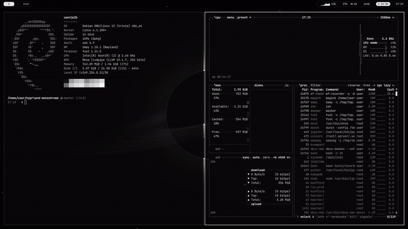
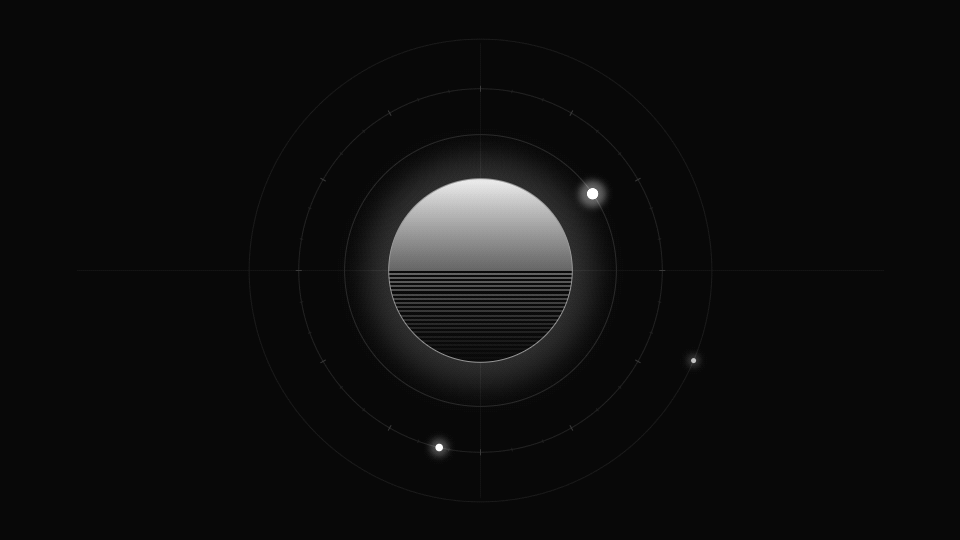
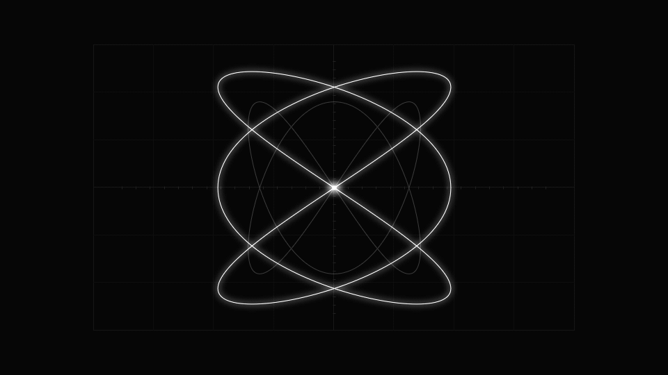

<div align="center">
  <a href="https://esoexe.github.io/hyprland-monochrome/">
    
  </a>

  <br />

  <p>
    <a href="https://esoexe.github.io/hyprland-monochrome/"></a>&nbsp;&nbsp;
    <a href="https://esoexe.github.io/hyprland-monochrome/newtab.html"></a>&nbsp;&nbsp;
    <a href="https://github.com/esoexe/hyprland-monochrome/releases/tag/v5.2.0"></a>
  </p>

  <p>
    <a href="https://github.com/esoexe/hyprland-monochrome/actions/workflows/ci.yml"></a>
    <a href="https://esoexe.github.io/hyprland-monochrome/"></a>
    <a href="https://github.com/esoexe/hyprland-monochrome/releases"></a>
    <a href="LICENSE"></a>
  </p>
</div>

A minimalist monochrome **Hyprland 0.56** Wayland desktop environment engineered in **C++20**, **Lua 5.4**, and **POSIX Shell**. Built around strict luminance hierarchy, damped physical spring motion, automatic GPU and display profiling across **Arch, EndeavourOS, CachyOS, Manjaro** (plus Debian/Ubuntu, Fedora, and openSUSE), universal application routing, and a cohesive `1px` structural browser suite.

---

## Live Compositor Overview

<p align="center">
  <a href="https://esoexe.github.io/hyprland-monochrome/#simulator">
    
  </a>
</p>

<p align="center">
  
</p>

---

## Recorded Wayland Session &amp; Kinetic Wallpapers

<p align="center">
  <a href="docs/desktop-demo.mp4">
    
  </a>
  <br />
  <sub>Real Wayland session captured inside the environment. Click the animation above for the full 1080p recording (<a href="docs/desktop-demo.mp4"><code>docs/desktop-demo.mp4</code></a>) or try the interactive browser simulator at <a href="https://esoexe.github.io/hyprland-monochrome/">esoexe.github.io/hyprland-monochrome</a>.</sub>
</p>

| Orbital Rings (`mono-live-01`) | Harmonic Pulse (`mono-live-02`) | Lissajous Scope (`mono-live-03`) |
| :---: | :---: | :---: |
|  |  |  |

---

## Core Capabilities

| Subsystem | What It Delivers |
| --- | --- |
| **Adaptive Hardware Engine (`hardware.lua` + `hardware.sh`)** | Sub-millisecond `/sys` and `/proc` startup inspection that configures **AMD Radeon**, **Intel Iris/Arc**, **NVIDIA RTX/GTX** (`nvidia-drm`, `nvidia_anti_flicker`, `no_hardware_cursors = 2`), **Hybrid Optimus laptops** (`AQ_DRM_DEVICES`, `AQ_FORCE_LINEAR_BLIT=0`), and **Virtual Machines** (QEMU/KVM/VMware/VirtualBox software fallback), alongside crisp zero-blur HiDPI XWayland scaling and multi-distro installation (`pacman`, `apt-get`, `dnf`, `zypper`). |
| **Universal Application Layer (`open-app.sh`)** | Seamless launch and rendering across native Wayland, X11/XWayland, Electron (`ELECTRON_OZONE_PLATFORM_HINT=auto`), Qt5/6, GTK3/4, SDL2 (`wayland,x11`), Java Swing and JetBrains IDEs (`_JAVA_AWT_WM_NONEREPARENTING=1`), **Flatpak**, **Snap**, **Nix**, auto-indexed **`.AppImage`** binaries (with FUSE-less `--appimage-extract-and-run` fallback), Windows `.exe`/`.msi` via Wine/Bottles, and `Super + Shift + O` universal file/URL dispatch. |
| **Monochrome Browser Suite (`browser-theme.sh`)** | Cohesive `1px` structural grid browser chrome (`#131010` surface, `#201d1d` elevated prompt, `#3d3838` dividers, `4px` corners, 100% monospace chrome): automated profile setup for **Firefox / Zen / LibreWolf / Floorp** (`userChrome.css`, `userContent.css`, Wayland prefs), **Chromium / Brave / Chrome / Vivaldi** Manifest V3 theme and new-tab extension, **Qutebrowser** palette, and offline **`startpage.html`** (`Alt + B`). |
| **Spring Physics &amp; Optical Glass (`animations.lua`, `appearance.lua`)** | Three damped physical spring curves (`silkSpring`, `drawerSpring`, `snappySpring`) driving 29 animation targets across windows, workspace parallax, and scratchpad drawers. Continuous G2 squircle geometry (`rounding_power = 4.0`), magnetic edge snapping, `direct_scanout`, and switchable optical glass (`kawase`, `xray`, `acrylic`) plus `Super + F12` low-latency **Direct Scanout / Game Mode**. |
| **Real-Time GLSL Shaders (`shader.sh`)** | Five GPU post-processing shaders (`Super + ,` or `Super + M` then `S`): **Noir** (Rec.709 hardware luminance), **35mm Film Grain**, **P4 Studio CRT**, **Matte E-Ink**, and **OLED Pitch** (true-black pixel power saving and micro-contrast). |
| **Command Palette &amp; Native `mono-calc`** | `Super + Shift + P` (or `Super + ;`) opens an omnibar for jumping to active windows, switching motion physics or GLSL shaders, toggling named drawers, managing workspace snapshots, running system diagnostics, and evaluating math expressions via the compiled C++20 `mono-calc` engine. |
| **Full-Stack Greyscale (`R == G == B`)** | Unified greyscale theming across all 7 desktop toolkits: GTK3/GTK4, Qt5/Qt6 (`qt5ct`/`qt6ct` 21-slot Fusion palette), zero-plugin Neovim (`monochrome.lua`), Kitty (`1ms` GPU cursor trail), Rofi, Waybar, Dunst OSDs, `hyprlock`, and optional Spicetify monochrome chrome. |
| **Capture, Replay &amp; Screen OCR (`record.sh`, `screenshot.sh`)** | `Super + C` opens the `CAPTURE` chord (`s` region, `f` full screen, `w` active window, `o` Tesseract region OCR to clipboard, `e` Satty/Swappy vector annotation, `r` start/stop recording, `p` save 60s instant replay) powered by `gpu-screen-recorder` with automatic `wf-recorder` fallback. |
| **Procedural C++20 Wallpapers** | `Super + W` (120 FPS `awww` transitions) and `Alt + W` (live animated loops): 17 procedural C++20 monochrome compositions (up to 4K/16K masters) plus 3 seamless kinetic GIF loops (`Orbital Rings`, `Harmonic Pulse`, `Lissajous Scope`). |

---

## Quick Install

```bash
git clone https://github.com/esoexe/hyprland-monochrome.git
cd hyprland-monochrome
./install.sh
```

What `./install.sh` performs:

1. Detects your Linux distribution (`Arch`, `EndeavourOS`, `CachyOS`, `Manjaro`, or `Debian`/`Ubuntu`/`Fedora`/`openSUSE`) and verifies compositor prerequisites.
2. Installs required packages from official repositories (`packages.txt`) and offers optional extras (`aur-packages.txt`) when `paru` or `yay` is present.
3. **Backs up every existing file before touching anything** (preserving a permanent `pristine/` snapshot of your original setup).
4. Installs `~/.config` modules (or symlinks them with `--link`), compiles native C++20 utilities, copies wallpapers, applies browser theming, and reloads Hyprland cleanly.

```text
./install.sh --help          list all installer flags
./install.sh --yes           non-interactive install
./install.sh --no-packages   deploy configuration files only
./install.sh --link          symlink configs into ~/.config for live git workflow
./install.sh --dry-run       preview every action without modifying disk
./uninstall.sh               remove installed configs and restore originals
```

### Backups &amp; Instant Rollback

```text
~/.config-backups/pristine/     exact snapshot prior to the very first install (never overwritten)
~/.config-backups/<timestamp>/  incremental backup for each subsequent run with restore.sh
```

```bash
~/.config-backups/pristine/restore.sh     # restore original files directly
./uninstall.sh                            # full uninstall + automatic restoration
./uninstall.sh --list                     # list available backup snapshots
```

---

## Essential Keybinds

`Super` is the primary modifier (configurable in `.config/hypr/modules/user.lua`). Press `Super + /` on the desktop or browse **[docs/KEYBINDS.md](docs/KEYBINDS.md)** (and the [live searchable table](https://esoexe.github.io/hyprland-monochrome/#keybinds)) for all **172** shortcuts.

| Keybind | Action | Keybind | Action |
| --- | --- | --- | --- |
| `Super + T` / `Super + Enter` | Kitty terminal | `Super + Shift + P` / `Super + ;` | Command palette &amp; `mono-calc` |
| `Super + D` | Application launcher | `Super + Shift + O` | Universal file / URL / AppImage opener |
| `Super + E` | File manager (`Thunar`) | `Super + Z` / `Super + Shift + Z` | Zen mode / Pomodoro focus timer |
| `Super + B` / `Alt + B` | Browser / Monochrome startpage | `Super + R` | `RESIZE` chord (`h/j/k/l`, `1-3/0` gaps) |
| `Super + I` | System settings menu | `Super + C` | `CAPTURE` chord (`s/f/w/o/e/r/p/m`) |
| `Super + W` / `Alt + W` | Wallpaper picker / Live loop | `Super + M` | `FX` chord (spring physics &amp; shaders) |
| `Super + ,` / `Super + .` | Cycle GLSL shader / PiP snap | `Super + \` / `Super + Shift + \` | Cycle tiling layout / gap presets |
| `Super + Shift + T` | Quake dropdown terminal | `Super + Shift + B` | Floating `btop++` telemetry drawer |
| `Super + '` | Scratchpad Markdown notes | `Super + Ctrl + S` | `SCRATCH` &amp; workspace session chord |
| `Super + V` | Clipboard history (`cliphist`) | `Super + F` / `Super + Space` | Fullscreen / Centered floating |
| `Super + Shift + W` | Toggle top Waybar | `Super + F12` | Direct Scanout / low-latency mode |
| `Super + Print` | Region screenshot | `Super + Alt + Print` | Start / stop screen recording |
| `Super + Tab` | Lock screen (`hyprlock`) | `Super + Escape` | Session power menu |

Window focus uses `Super + H/J/K/L` (or arrow keys), moving uses `Super + Shift + H/J/K/L`, resizing uses `Super + Ctrl + H/J/K/L`, and workspaces switch with `Super + 1..0` or `Super + Scroll`.

---

## Repository &amp; Configuration Architecture

```text
hyprland-monochrome/
|-- .config/hypr/
|   |-- hyprland.lua            entry point loading modular Lua configuration
|   |-- hyprlock.conf           minimal monochrome lock screen
|   |-- hypridle.conf           dim -> lock -> DPMS off -> suspend pipeline
|   |-- hyprsunset.conf         scheduled night-light colour temperature
|   |-- modules/
|   |   |-- user.lua            single source of truth for apps, gaps, layout & preferences
|   |   |-- hardware.lua        GPU, DRM, cursor, VRR & XWayland auto-configuration
|   |   |-- monitors.lua        automatic display scaling & multi-head layout
|   |   |-- appearance.lua      G2 squircles, borders, optical glass & trackpad gestures
|   |   |-- animations.lua      3 physical spring curves + 29 animation targets
|   |   |-- binds.lua           172 shortcuts + RESIZE / CAPTURE / SCRATCH / FX / GROUP chords
|   |   |-- rules.lua           universal Wayland, X11, Electron, Java & Steam window rules
|   |   `-- smart.lua           reactive hl.on() hooks (screenshare DND, monitor hotplug)
|   |-- shaders/                5 GLSL ES 3.00 post-processing shaders
|   |-- src/mono-calc.cpp       native C++20 expression evaluator
|   `-- scripts/                compositor runtime scripts (hardware, open-app, record, shader)
|-- site/                       live 60 FPS interactive website + C++20 HTTP server (serve-site)
|-- wallpapers/                 C++20 procedural generator + 17 stills + 3 animated GIF loops
|-- tools/                      C++20 build, keybind sync, verification & static server tools
`-- windows/                    matching GlazeWM + Windows Terminal dual-boot kit
```

---

## Customization &amp; Local Development

Edit **`~/.config/hypr/modules/user.lua`** to customize default applications, outer/inner gaps, blur, keyboard layouts, or motion profiles in one place:

```lua
-- ~/.config/hypr/modules/user.lua
browser      = "zen-browser",   -- auto-falls back across installed browsers if absent
gaps_out     = 14,
blur_enabled = true,
kb_layout    = "us",            -- Super + X switches active layouts
```

Build the native C++20 tools, run the verification suite, or launch the interactive website locally:

```bash
make -j"$(nproc)"               # compile all C++20 binaries (-std=c++20 -O3 -Wall -Wextra -Werror)
make docs                       # sync docs/KEYBINDS.md, site/keybinds.json, windows/* & preview
make test                       # run full 10-suite verification harness
make serve                      # serve the live animated website at http://0.0.0.0:8080
```
